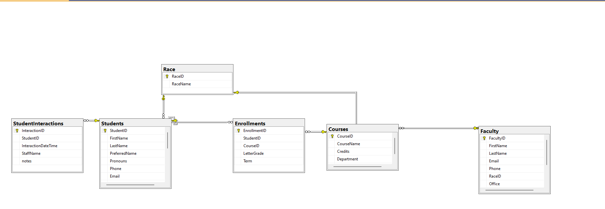
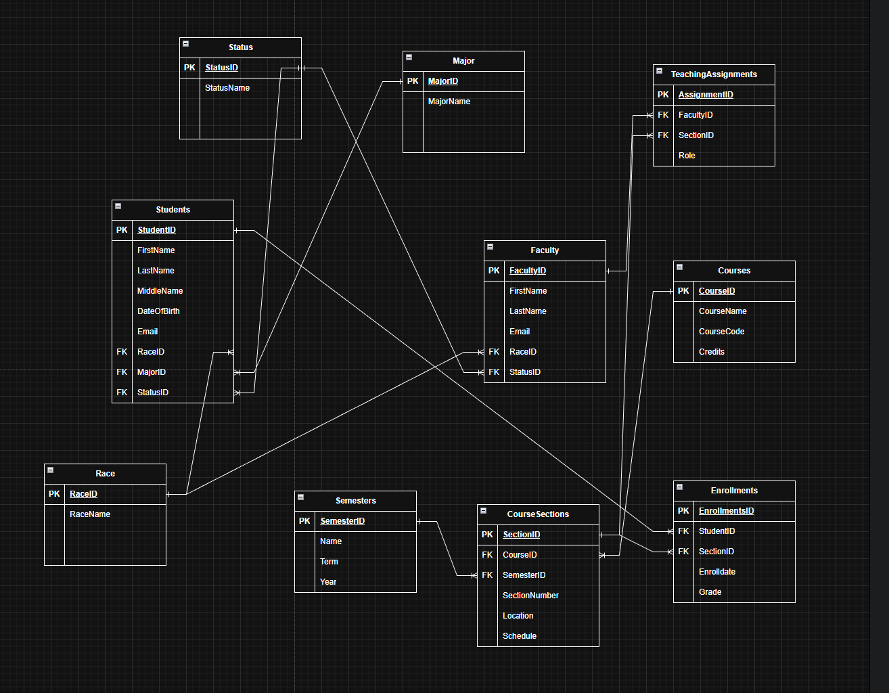

# Student Records Database

A relational database I designed and built in **Microsoft SQL Server** for a case study: an education services company that manages student, faculty, course and enrollment records for several client schools.

I took it from a first ER diagram to working tables, data and queries, and redesigned it as new requirements came in.

**Tools:** Microsoft SQL Server 2022 · SQL Server Management Studio (SSMS) · T-SQL · draw.io

## Final design

| Table | What it stores |
| --- | --- |
| `Students` | Student details, including preferred name and pronouns |
| `Faculty` | Instructor and staff details |
| `Courses` | Course catalog with credits and department |
| `Enrollments` | Every course a student has taken, with term and letter grade |
| `StudentInteractions` | Log of staff meetings with a student: date/time, staff name, notes |
| `Race` | Lookup table shared by `Students` and `Faculty` |

Each table uses an auto-numbered ID (`IDENTITY`) as its primary key, and foreign keys tie the tables together so a record can't point at a student or course that doesn't exist.

## Design decisions

- **GPA is calculated, not stored.** GPA changes every time a grade or credit value changes, so a saved GPA column would go stale. It is computed from `Enrollments.LetterGrade` and `Courses.Credits` when a transcript or report is run.
- **Enrollments is a history table.** One row per course taken, per term, so a full transcript can be built for any student.
- **Built for international students.** Adding a student from a Canadian school broke the original U.S.-only design. I added `Province` and `Zip Code` columns, stored postal codes as text because Canadian codes contain letters, and made optional fields NULLable because older data sets didn't include them.
- **Requirements changed the design.** `StudentInteractions` was added after I found that administrators need to log meetings and notes. Preferred name and pronouns were added to `Students` for how schools communicate with students today.
- **Lookup tables avoid duplicate data.** Values like race live in one table and are referenced by ID, so they stay consistent.

**Lesson learned:** most of the rework came from not planning early for different schools and data formats. Next time I'd check the source data more carefully up front and design for non-U.S. data from the start.

## How it evolved

My first draft in draw.io split things further, with separate tables for majors, statuses, semesters, course sections and teaching assignments:

As I worked through the requirements, the final version in SSMS became simpler and more focused on what the client needed: student records, transcripts and interaction notes.

## Files

| Path | Contents |
| --- | --- |
| [`schema/create_tables.sql`](schema/create_tables.sql) | `CREATE TABLE` statements with keys and relationships |
| [`data/sample_data.sql`](data/sample_data.sql) | Sample `INSERT` (fictional data) |
| [`queries/reporting_queries.sql`](queries/reporting_queries.sql) | Queries used to check each table |
| [`sql-practice/adventureworks_queries.sql`](sql-practice/adventureworks_queries.sql) | Practice queries against Microsoft's AdventureWorks sample database: filtering, NULL handling, string and date functions, `GROUP BY`, and joins, including a `LEFT JOIN` that finds products that have never sold |

## Background

Built during a Database Fundamentals course at Columbus State Community College (Fall 2025). All people and records in this repo are fictional.
